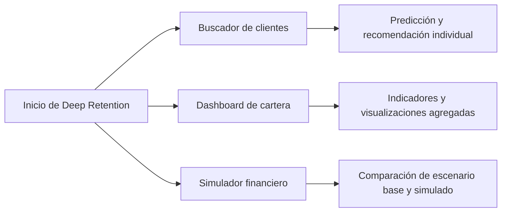

# Aplicación Streamlit

[Volver al README](../README.MD) · [Arquitectura](architecture.md) · [Modelo financiero](financial-model.md) · [Desarrollo](development.md)

## Estado y elección tecnológica

La aplicación está **planificada y aún no implementada**. Streamlit se elige porque permite construir una interfaz de análisis en Python, compartir el mismo entorno del modelo y ejecutar la demostración con un único comando, sin un frontend separado ni una API REST.

La aplicación será una capa de presentación y coordinación. No entrenará modelos, no ajustará el preprocesador, no cambiará los CSV y no contendrá las fórmulas financieras centrales dentro de los componentes visuales.

## Navegación

La interfaz tendrá tres secciones principales:



Una barra lateral o mecanismo equivalente permitirá cambiar de sección y mostrará el estado de carga de datos y artefactos. La decisión visual definitiva se tomará al implementar, manteniendo una navegación simple.

## Buscador de clientes

El usuario introducirá o seleccionará un `CustomerId`. La aplicación validará el identificador, recuperará exactamente un registro y mostrará:

- ID, apellido y género;
- características bancarias utilizadas por el modelo;
- saldo bancario;
- probabilidad inferida de abandono;
- segmento descriptivo de riesgo;
- margen neto anual simulado;
- incentivo recomendado o no intervención;
- costo comparable del incentivo;
- ganancia neta esperada;
- decisión comercial y motivo.

`Exited` podrá reservarse para evaluación histórica fuera de la experiencia operativa, pero jamás se usará como sustituto de la predicción. La interfaz deberá etiquetar claramente los importes y resultados simulados.

### Comportamientos esperados

- ID inexistente: mensaje informativo, sin conservar resultados de una consulta anterior.
- ID duplicado: error de integridad; no elegir arbitrariamente una fila.
- Datos inválidos o incompletos: indicar los campos afectados y no producir una recomendación engañosa.
- Modelo no disponible: mostrar el problema y deshabilitar predicción y decisión financiera dependiente.
- Ninguna intervención rentable: mostrar «No intervención» y su causa.

## Dashboard de cartera

El dashboard ejecutará inferencia por lotes con el mismo preprocesador y modelo que la consulta individual. Incluirá:

- clientes analizados;
- capital total en riesgo, una vez aprobada su definición exacta;
- clientes en segmento de alto riesgo;
- capital rescatable estimado;
- inversión total en incentivos;
- ganancia neta esperada total;
- ROI proyectado;
- distribución de clientes por nivel de riesgo;
- visualizaciones financieras relevantes.

Cada tarjeta deberá mostrar unidad, período y naturaleza proyectada. Los conteos de riesgo no se confundirán con intervenciones autorizadas. Las definiciones económicas se centralizarán en `src/financial.py` y `src/analytics.py`, no se recalcularán informalmente en la interfaz.

### Visualizaciones previstas

- distribución de probabilidades y segmentos de riesgo;
- abandono histórico frente a variables relevantes, solo en contexto analítico;
- inversión y GNE por tipo de incentivo;
- capital rescatable y GNE agregada;
- relación entre riesgo, margen y decisión;
- comparación de escenario base y simulado.

Plotly se priorizará para interacción; Matplotlib podrá utilizarse en gráficos de evaluación o cuando resulte más adecuado. No se añadirán gráficos sin pregunta analítica clara.

## Simulador financiero

El simulador permitirá modificar temporalmente costos, efectividades y otros supuestos aprobados. Tras cada cambio recalculará:

- decisiones comerciales;
- número de clientes elegibles e intervenidos;
- inversión total;
- capital rescatable estimado;
- GNE total;
- ROI proyectado.

La interfaz distinguirá el escenario base del modificado, validará rangos y ofrecerá restablecimiento. Ninguna acción escribirá en los CSV ni sustituirá los parámetros oficiales en disco.

## Carga de datos y artefactos

Al arrancar, la aplicación deberá localizar y validar:

```text
data/Deep_Retention_Dataset.csv
data/incentivos.csv
models/preprocesador.joblib
models/modelo_churn.keras
```

La aplicación resolverá estas rutas respecto a la raíz del proyecto, sin depender del directorio desde el que se invoque el proceso.

Secuencia de inicialización:

1. resolver rutas respecto a la raíz del proyecto;
2. validar presencia, legibilidad y esquema de los CSV;
3. cargar el preprocesador y el modelo compatibles;
4. comprobar las características esperadas;
5. ejecutar validaciones ligeras, sin entrenar;
6. habilitar las secciones dependientes.

No habrá descargas externas obligatorias durante el inicio.

## Estado y caché

Se prevén dos niveles:

- caché de recursos para modelo y preprocesador, que son objetos reutilizables e inmutables durante la sesión;
- caché de datos para lecturas validadas de CSV, invalidable cuando cambie el archivo.

Los parámetros del simulador, el cliente seleccionado y filtros de visualización pertenecerán al estado de sesión. Las funciones almacenadas en caché no mutarán los DataFrames compartidos; cada simulación operará sobre copias o resultados derivados.

Al implementar se elegirá la API de caché compatible con la versión fijada de Streamlit y se probará su invalidación.

## Tratamiento de errores

| Situación | Respuesta esperada |
|---|---|
| CSV ausente o ilegible | Mensaje con el recurso esperado; detener las vistas dependientes. |
| Esquema incompatible | Enumerar columnas faltantes o inválidas sin exponer una traza al usuario final. |
| Catálogo ausente | Permitir, si es seguro, explorar datos; deshabilitar recomendaciones financieras. |
| Artefactos ausentes o incompatibles | Deshabilitar inferencia y explicar que se requieren artefactos entrenados. |
| Probabilidad no finita o fuera de rango | Rechazar el resultado y registrar el diagnóstico técnico. |
| Parámetro financiero inválido | Marcar el control, conservar el último escenario válido y no recalcular. |
| Inversión total igual a cero | Mostrar ROI como «No aplicable». |

Los errores esperados se transformarán en mensajes accionables. Los detalles diagnósticos se conservarán para desarrollo sin mostrar información sensible ni resultados parciales engañosos.

## Accesibilidad y claridad

- No depender solo del color para indicar riesgo o rentabilidad.
- Añadir etiquetas, leyendas y unidades a cifras y gráficos.
- Formatear probabilidades como porcentajes sin perder precisión en los cálculos.
- Informar que las variables financieras y las proyecciones son simuladas.
- Mantener textos breves y permitir consultar la explicación de GNE.
- Diferenciar probabilidad, segmento, elegibilidad y decisión final.

## Ejecución prevista

Desde la raíz del proyecto y con `uv` instalado:

```bash
uv run streamlit run app.py
```

`uv` resolverá el entorno bloqueado por `pyproject.toml`, `uv.lock` y `.python-version`. La primera ejecución podrá necesitar Internet para dependencias; después, la aplicación no deberá requerir descargar datasets o modelos. Este comando todavía no funciona porque `app.py`, el catálogo y los artefactos entrenados no existen.

## Criterios de aceptación

- Las tres secciones son accesibles y coherentes.
- Consulta individual y lote generan la misma probabilidad para el mismo registro.
- Toda probabilidad procede del artefacto exportado.
- El motor aplica `GNE > 0` y excluye clientes deficitarios.
- Los escenarios no modifican archivos.
- La interfaz identifica supuestos y datos simulados.
- La aplicación inicia con el comando oficial en un clon limpio preparado para entrega.
- Los fallos de recursos o esquema se comunican sin producir resultados inválidos.
