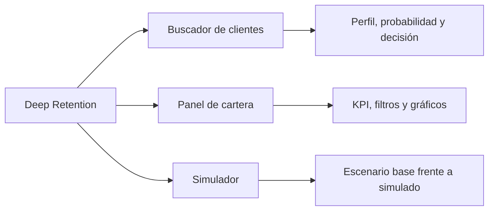

# Aplicación Streamlit

[Volver al README](../README.MD) · [Arquitectura](architecture.md) · [Modelo financiero](financial-model.md) · [Desarrollo](development.md)

## Estado

La aplicación está implementada en [`app.py`](../app.py) y se ejecuta con los artefactos ya exportados. Es una capa de presentación y coordinación: no entrena el MLP, no ajusta el preprocesador y no escribe sobre los CSV.

```bash
uv run streamlit run app.py
```

La interfaz tiene tres secciones accesibles desde la barra lateral:



## Buscador de clientes

La consulta acepta un `CustomerId`, comprueba que exista una sola fila y muestra:

- identificación y contexto bancario del cliente;
- saldo en su unidad original no declarada;
- variables financieras simuladas etiquetadas en USD;
- probabilidad ajustada de abandono y nivel visual de riesgo;
- decisión `Retener`, `No intervención` o `Salida permitida`;
- incentivo, costo, GNE y explicación de la decisión;
- detalle auditable de todas las alternativas evaluadas.

El nivel de riesgo es descriptivo. No autoriza por sí solo un incentivo: la recomendación utiliza elegibilidad comercial, margen y GNE. Un identificador inválido o inexistente genera un mensaje comprensible y no una recomendación parcial.

## Panel de cartera

La aplicación realiza una sola inferencia por lotes para los 10.000 clientes y reutiliza esas probabilidades. El escenario base expone:

- clientes analizados y distribución de decisiones;
- inversión, valor esperado a rescatar, GNE y ROI proyectados;
- saldo expuesto, definido como `Σ(probabilidad × Balance)` y conservado en la unidad original de `Balance`;
- abandonos esperados evitados, definido como `Σ(probabilidad × efectividad)` para intervenciones seleccionadas;
- efectividad ponderada por riesgo de las intervenciones;
- histogramas, distribuciones, relación riesgo-margen e indicadores por incentivo;
- tabla ordenable de clientes y oportunidades.

Los filtros por país, rentabilidad, decisión, incentivo y probabilidad operan sobre resultados ya calculados. No vuelven a estimar percentiles ni cambian decisiones, por lo que un mismo cliente conserva la recomendación del escenario de referencia.

## Simulador

El simulador permite modificar temporalmente el costo y la efectividad de los cuatro incentivos. Mantiene constantes:

- las probabilidades producidas por el MLP;
- los percentiles comerciales del escenario base;
- los datos de clientes y los archivos originales.

Al recalcular, el motor financiero vuelve a evaluar elegibilidad económica y GNE con una copia del catálogo. Se muestran diferencias absolutas y porcentuales, distribución de incentivos y KPI del escenario simulado. El botón de restablecimiento recupera los valores oficiales. Ningún cambio se persiste en disco.

## Carga y caché

La aplicación resuelve las rutas desde la raíz del proyecto y valida:

```text
data/processed/clientes_limpios.csv
data/incentivos.csv
models/preprocesador.joblib
models/modelo_churn.keras
models/correccion_probabilidades.json
```

Se utiliza `st.cache_resource` para el predictor y `st.cache_data` para datos, probabilidades, cartera base y escenarios. Una huella de los CSV invalida la caché cuando cambia una fuente. Los parámetros editables permanecen en `session_state`.

## Tratamiento de errores

| Situación | Comportamiento |
|---|---|
| Dataset o catálogo ausente | Se detiene el inicio con un mensaje sobre el recurso esperado. |
| Esquema incompatible | Se indican las columnas requeridas faltantes. |
| `CustomerId` inválido o inexistente | Se informa el problema sin mostrar una decisión. |
| Artefactos incompatibles | El predictor rechaza la carga o la entrada antes de inferir. |
| Parámetro simulado fuera de rango | El control o el validador impide calcular el escenario. |
| Inversión igual a cero | El ROI se presenta como no aplicable. |
| Filtros sin resultados | Se muestran KPI nulos y un aviso, sin gráficos engañosos. |

## Interpretación responsable

Los costos, las efectividades y las variables financieras con sufijo `_Sim` son supuestos académicos. La GNE, el ROI, el valor a rescatar y los abandonos evitados son valores esperados, no beneficios observados ni evidencia causal. La unidad de `Balance` no se etiqueta como USD.

## Verificación

La suite comprueba la búsqueda de clientes, los KPI base, la coherencia entre consulta individual y cartera, la estabilidad de decisiones al filtrar, la inmutabilidad del catálogo, escenarios límite y el inicio real de Streamlit. La aplicación también fue iniciada localmente y su endpoint de salud respondió correctamente.
