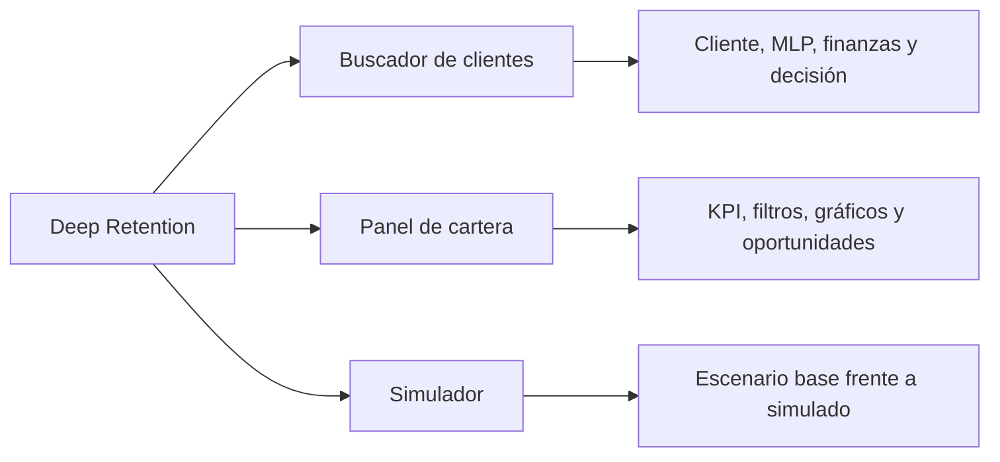

# Aplicación Streamlit

[Volver al README](../README.MD) · [Arquitectura](architecture.md) · [Modelo financiero](financial-model.md) · [Desarrollo](development.md)

## Estado y ejecución

La aplicación está implementada como un monolito modular. `app.py` inicializa la página y la navegación; `ui/pages/` contiene las tres vistas; `ui/services.py` coordina datos, caché, inferencia y escenarios. No entrena el MLP, no regenera variables financieras y no escribe en los CSV.

Desde la raíz del proyecto:

```bash
uv run streamlit run app.py
```



## Fuente y contratos

La aplicación utiliza:

```text
data/processed/clientes_financieros_simulados.csv
data/incentivos.csv
models/preprocesador.joblib
models/modelo_churn.keras
models/correccion_probabilidades.json
```

El CSV de clientes contiene 10.000 filas, 18 columnas originales y ocho simuladas. `src/data_processing.py` valida esquema, identificadores únicos, valores numéricos finitos, importes no negativos cuando corresponde y coherencia entre margen y segmento de rentabilidad.

Las probabilidades conservan el orden de `CustomerId`. El MLP recibe solo sus nueve características originales; las columnas financieras, `Exited` y `Complain` no entran a la inferencia.

## Buscador de clientes

La consulta por `CustomerId` está organizada en cuatro bloques.

### A. Identificación y perfil bancario

Muestra identificador, apellido, edad, país, antigüedad, saldo, productos y condición de cliente activo. `Balance` conserva su unidad original no declarada.

Una entrada no numérica o un identificador inexistente produce un aviso comprensible y no una recomendación parcial.

### B. Predicción del modelo neuronal

Presenta:

- puntaje del MLP como probabilidad ajustada;
- porcentaje de abandono estimado;
- clasificación descriptiva del riesgo;
- barra visual de progreso;
- aclaración de que la probabilidad no es certeza ni `CreditScore`.

El nivel visual de riesgo no autoriza incentivos. La decisión depende de margen, elegibilidad y Ganancia Neta Esperada (GNE).

### C. Información financiera simulada

Muestra transacciones y volumen mensuales, comisión promedio, ingresos por comisiones, contribución financiera anual, costos operativos, margen neto anual y segmento `Rentable` o `Deficitario`.

### D. Decisión comercial recomendada

Presenta `Retener`, `No intervención` o `Salida permitida`, junto con incentivo, costo, efectividad hipotética, beneficio bruto esperado y GNE. Para una retención se muestra la fórmula con los valores concretos del cliente.

- Un cliente deficitario no recibe gasto.
- Un cliente sin intervención puede generar margen, pero el beneficio, costo y GNE de una campaña no ejecutada son cero.
- Un desplegable permite auditar las cuatro alternativas, su elegibilidad, GNE y motivos de rechazo.

La búsqueda individual carga el predictor al solicitar un cliente y utiliza los percentiles calculados sobre la cartera completa; no necesita construir previamente todas las decisiones.

## Panel ejecutivo de cartera

La primera apertura del panel ejecuta inferencia por lotes para 10.000 clientes y conserva las probabilidades en caché.

### Indicadores

El panel muestra:

1. clientes analizados;
2. rentables;
3. deficitarios;
4. retener;
5. no intervención;
6. salida permitida;
7. inversión proyectada;
8. beneficio bruto esperado;
9. Ganancia Neta Esperada total;
10. ROI proyectado;
11. saldo expuesto;
12. abandonos esperados evitados y efectividad ponderada por riesgo.

El saldo expuesto es `Σ(P_f × Balance)` y se presenta en unidades originales, nunca como USD. No equivale a dinero perdido ni a beneficio recuperable. Los indicadores de efectividad dependen de probabilidades y efectividades hipotéticas, no de campañas observadas.

### Filtros

Los filtros disponibles son país, rentabilidad, decisión, incentivo y rango de probabilidad. Actualizan KPI, gráficos y tabla del subconjunto, pero no recalculan percentiles ni cambian decisiones previamente obtenidas con la cartera completa.

### Gráficos

Las pestañas muestran:

- distribución de probabilidades y clientes rentables/deficitarios;
- distribución de decisiones, incentivos recomendados y relación riesgo–margen;
- inversión y GNE por incentivo, y rentabilidad por decisión.

### Tabla ejecutiva

La tabla ordenada por GNE contiene `CustomerId`, probabilidad, margen neto, rentabilidad, incentivo, costo, GNE y decisión. Las oportunidades con mayor GNE aparecen primero.

## Simulador de campañas

El simulador muestra los valores base y permite modificar temporalmente:

- costo anual de cada incentivo;
- efectividad hipotética, como parámetro académico adicional.

Los controles impiden costos negativos y efectividades fuera de `[0, 1]`. Al recalcular:

1. se crea una copia del catálogo en memoria;
2. se conservan datos, probabilidades del MLP y percentiles base;
3. se reevalúan elegibilidad, GNE, incentivo óptimo y decisiones;
4. se actualizan indicadores y visualizaciones.

El MLP no se reentrena ni vuelve a inferir cuando solo cambian costos o efectividades.

La comparación incluye clientes a retener, inversión, beneficio bruto esperado, GNE, ROI y abandonos esperados evitados, con diferencias absolutas y porcentuales cuando son matemáticamente aplicables. También muestra gráficos base/simulado de inversión, GNE y distribución de incentivos.

**Restablecer valores originales** recupera costos y efectividades de `data/incentivos.csv`. Ninguna simulación persiste en disco.

## Caché e invalidación

`ui/services.py` utiliza:

- `st.cache_resource` para una instancia de `PredictorFuga` por versión;
- `st.cache_data` para clientes, catálogo, percentiles, probabilidades, escenario base, consultas y simulaciones.

La versión se calcula con nombre, tamaño y fecha de modificación de los cinco recursos. Reemplazar el CSV financiero, el catálogo o un artefacto produce una clave nueva y evita reutilizar resultados incompatibles.

## Manejo de errores

| Situación | Comportamiento |
|---|---|
| Recurso ausente o esquema incompleto | Inicio detenido con mensaje seguro. |
| `CustomerId` inválido o inexistente | Aviso sin decisión parcial. |
| Artefactos incompatibles | Inferencia rechazada antes de producir resultados. |
| Valores financieros no finitos o incoherentes | Carga rechazada. |
| Costo o efectividad fuera de dominio | Control y validador impiden el escenario. |
| Inversión cero | ROI presentado como no aplicable. |
| Filtros sin resultados | KPI nulos y aviso, sin gráficos engañosos. |

Las excepciones técnicas se registran en el servidor y la interfaz muestra mensajes comprensibles, sin trazas ni rutas locales.

## Transparencia e interpretación

La aplicación diferencia:

- datos observados del CSV original;
- probabilidades estimadas por el MLP;
- variables financieras simuladas;
- efectividades hipotéticas de los incentivos;
- beneficios económicos proyectados.

GNE, ROI y abandonos esperados evitados no son resultados reales. La herramienta es un apoyo académico para explorar decisiones bajo supuestos explícitos.

## Verificación funcional

Las pruebas automatizadas cubren búsqueda existente e inexistente, correspondencia entre consulta y cartera, indicadores base, filtros, estabilidad de decisiones, simulación sin mutación, parámetros inválidos, firma de recursos y navegación mediante `streamlit.testing.v1.AppTest`.

La verificación de la integración también incluyó arranque real, búsqueda, panel, recálculo y restablecimiento del simulador. Las cifras de referencia permanecen en el [modelo financiero](financial-model.md).
