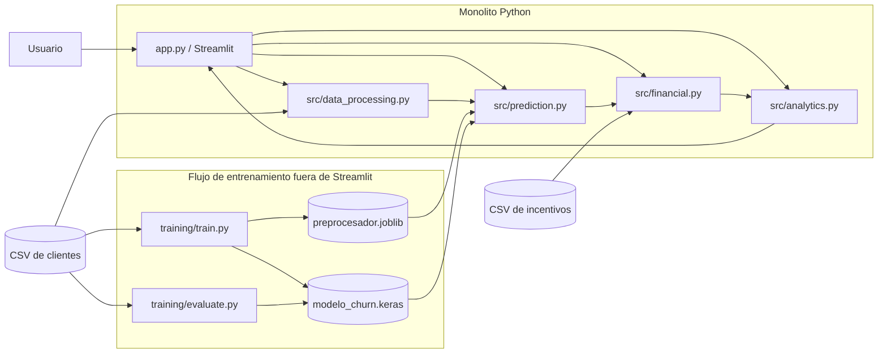
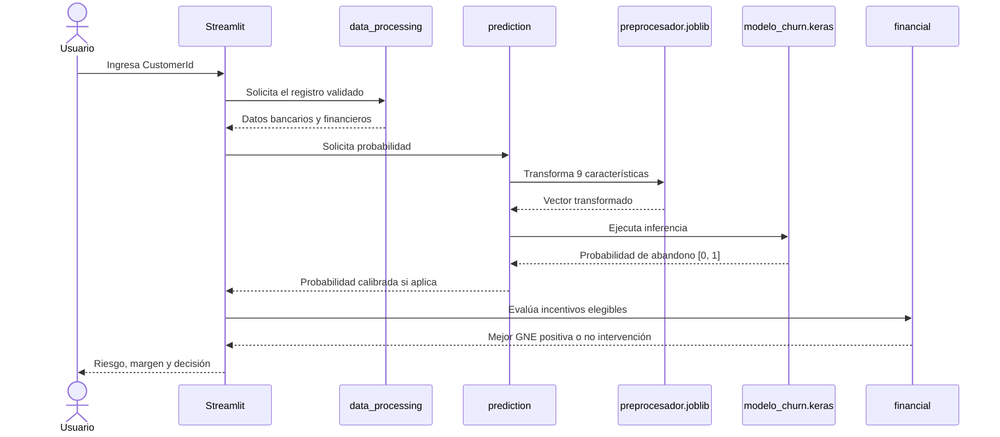

# Arquitectura de la solución

[Volver al README](../README.MD) · [Dataset](dataset.md) · [Aprendizaje automático](machine-learning.md) · [Modelo financiero](financial-model.md) · [Aplicación](application.md)

## Estado del documento

Este documento define la arquitectura de aplicación **planificada**. Actualmente están disponibles la documentación, el dataset en `data/Deep_Retention_Dataset.csv`, el notebook de EDA ejecutado y el entorno bloqueado con `uv`; no existen todavía componentes de inferencia, finanzas o Streamlit.

## Estilo arquitectónico

Deep Retention será un monolito Python sencillo, desplegable y ejecutable como una única aplicación Streamlit. La organización será modular por responsabilidad funcional, sin capas ceremoniales ni patrones que no aporten valor al alcance académico.

La solución no utilizará:

- bases de datos relacionales;
- Docker o Docker Compose;
- microservicios o arquitectura distribuida;
- API REST;
- Domain-Driven Design, entidades, objetos de valor o repositorios;
- puertos, adaptadores, Mediator ni un frontend independiente.

Esta decisión reduce la preparación necesaria para la demostración y mantiene explícita la separación entre datos, inferencia, cálculo financiero y presentación.

## Componentes y responsabilidades

| Componente previsto | Responsabilidad | Dependencias principales |
|---|---|---|
| `app.py` | Navegación, entrada del usuario y presentación en Streamlit. | Módulos de `src/`; no contiene entrenamiento. |
| `src/data_processing.py` | Lectura de CSV, validación de esquema y preparación de entradas. | Pandas, preprocesador exportado cuando corresponda. |
| `src/prediction.py` | Carga del modelo y del preprocesador; predicción individual y por lotes. | TensorFlow/Keras, Joblib. |
| `src/financial.py` | Elegibilidad, GNE, selección del incentivo y decisión de no intervención. | Dataset financiero y catálogo de incentivos. |
| `src/analytics.py` | Agregados de cartera, ROI y datos para visualizaciones. | Predicciones y decisiones financieras. |
| `training/train.py` | División de datos, ajuste del preprocesador y entrenamiento del MLP. | Pandas, Scikit-learn, TensorFlow/Keras. |
| `training/evaluate.py` | Métricas, calibración, explicabilidad y evaluación final. | Modelo, preprocesador y conjunto de prueba. |
| Archivos CSV | Fuente local de clientes e incentivos. | Sin servidor de base de datos. |
| Artefactos en `models/` | Modelo y preprocesador versionados para inferencia. | Cargados al iniciar Streamlit, nunca reentrenados allí. |

## Diagrama de arquitectura



Las flechas desde entrenamiento hacia los artefactos representan un proceso separado de la aplicación. La aplicación solo consume artefactos ya generados.

## Flujo de una consulta individual



## Contratos entre componentes

### Datos hacia predicción

El módulo de predicción recibirá exactamente estas características, con nombres y tipos validados:

`CreditScore`, `Geography`, `Age`, `Tenure`, `Balance`, `NumOfProducts`, `HasCrCard`, `IsActiveMember` y `EstimatedSalary`.

No aceptará `Exited`, identificadores, variables demográficas excluidas ni variables financieras simuladas como entradas del MLP.

### Predicción hacia finanzas

El contrato mínimo es una probabilidad finita dentro de `[0, 1]`, asociada inequívocamente a un `CustomerId`. El motor financiero combina esa probabilidad con el margen del cliente y los parámetros de cada incentivo; no conoce detalles internos de TensorFlow.

### Finanzas hacia presentación

El resultado deberá conservar el incentivo evaluado, elegibilidad, costo comparable, efectividad, GNE y motivo de la decisión. Cuando no haya alternativa rentable o el cliente sea deficitario, se devolverá explícitamente «No intervención».

## Gestión de archivos

La persistencia será exclusivamente local mediante CSV y artefactos serializados:

- El dataset actual es `data/Deep_Retention_Dataset.csv` y se trata como entrada de solo lectura.
- El catálogo esperado `Deep_Retention_Catalogo_Incentivos.csv` aún no está disponible; su esquema solo se documentará después de inspeccionarlo.
- `models/modelo_churn.keras` almacenará la red entrenada.
- `models/preprocesador.joblib` almacenará el pipeline ajustado con el conjunto de entrenamiento.

La aplicación tratará estos archivos como entradas de solo lectura. Las simulaciones vivirán en el estado de sesión de Streamlit y no sobrescribirán los CSV.

## Inicio y ciclo de vida

Al iniciar, Streamlit deberá validar la existencia y compatibilidad de los cuatro recursos necesarios: clientes, incentivos, preprocesador y modelo. Los recursos inmutables podrán cargarse con caché. Un fallo debe producir un mensaje comprensible y detener únicamente la funcionalidad afectada, sin presentar resultados parciales como válidos.

La ejecución oficial prevista será:

```bash
uv run streamlit run app.py
```

La primera ejecución podrá requerir Internet para resolver dependencias. El funcionamiento normal no dependerá de descargas externas de datos o modelos.

## Decisiones y límites

- La separación funcional facilita las pruebas sin introducir una arquitectura distribuida.
- CSV simplifica la demostración, pero no ofrece concurrencia, control transaccional ni escalabilidad de una base de datos.
- Los artefactos deben crearse con versiones compatibles con el entorno de inferencia.
- Los resultados financieros son proyecciones basadas en datos y supuestos simulados, no resultados reales de una campaña.
- La distribución del dataset y de los artefactos queda condicionada a comprobar licencia y tamaño antes de la entrega.
