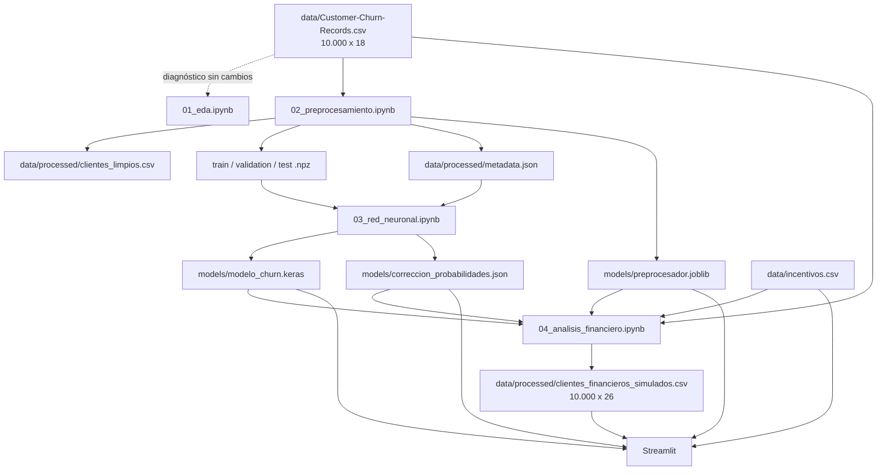
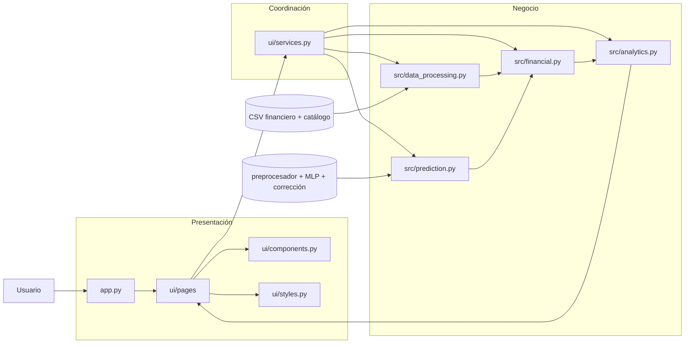
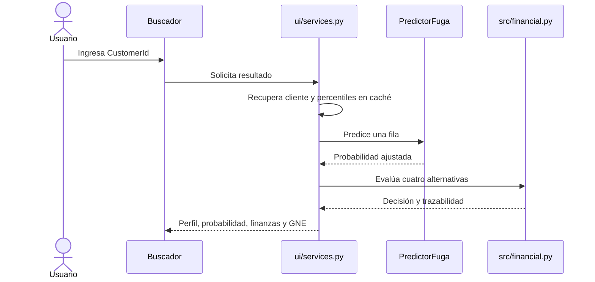

# Arquitectura de la solución

[Volver al README](../README.MD) · [Dataset](dataset.md) · [Aprendizaje automático](machine-learning.md) · [Modelo financiero](financial-model.md) · [Aplicación](application.md)

## Estilo arquitectónico

Deep Retention es un monolito Python modular ejecutado como una aplicación Streamlit. Separa preparación de datos, entrenamiento, inferencia, reglas financieras, analítica y presentación, sin introducir servicios externos.

No se implementan base de datos, API REST, microservicios, Docker ni un frontend independiente. Los CSV y artefactos versionados son entradas locales de solo lectura para la aplicación.

## Responsabilidades

| Componente | Responsabilidad |
|---|---|
| `app.py` | Configurar Streamlit, cargar el estado mínimo, gestionar navegación y convertir fallos generales en mensajes seguros. |
| `src/constants.py` | Definir raíz, rutas de recursos y las nueve características del MLP. |
| `src/data_processing.py` | Cargar y validar el CSV financiero y el catálogo; buscar clientes; crear catálogos temporales. |
| `src/prediction.py` | Cargar y validar preprocesador, modelo y corrección; inferir individualmente o por lotes. |
| `src/financial.py` | Validar incentivos, calcular percentiles, evaluar elegibilidad, GNE y decisiones. |
| `src/analytics.py` | Enriquecer resultados, calcular KPI, filtrar resultados existentes y comparar escenarios. |
| `ui/services.py` | Coordinar recursos, firma de versión, caché, inferencia y escenarios base/simulado. |
| `ui/pages/buscador.py` | Presentar perfil, predicción, finanzas y recomendación individual. |
| `ui/pages/dashboard.py` | Presentar filtros, KPI, gráficos y tabla ejecutiva. |
| `ui/pages/simulador.py` | Gestionar formulario, estado temporal y comparación de escenarios. |
| `ui/components.py` | Formatos, tarjetas KPI y aviso académico compartidos. |
| `ui/styles.py` | Paleta y CSS visual compartido. |

## Flujo completo de datos



El EDA no transforma datos. El notebook 02 genera la copia limpia y el contrato de preprocesamiento. El notebook 03 consume las particiones transformadas y exporta el MLP y su corrección. El notebook 04 vuelve al CSV original, añade ocho columnas simuladas y exporta la fuente usada por Streamlit.

## Arquitectura de ejecución



## Flujo de inferencia y decisión

1. `data_processing` valida clientes y catálogo.
2. `PredictorFuga` selecciona nueve características; las ocho financieras, `Exited` y `Complain` quedan fuera.
3. `preprocesador.joblib` transforma 9 entradas originales en 11 valores.
4. `modelo_churn.keras` produce una salida Sigmoid.
5. `correccion_probabilidades.json` aplica la corrección analítica por pesos de clase.
6. `financial` combina probabilidad, margen neto simulado y catálogo; evalúa elegibilidad y Ganancia Neta Esperada (GNE).
7. `analytics` agrega contexto, indicadores y comparaciones.
8. Las páginas presentan los resultados sin duplicar las reglas.

La identidad entre cliente y probabilidad se conserva por orden en inferencia por lotes y por `CustomerId` al unir resultados.

## Consulta individual



La consulta individual no necesita construir la cartera completa. El panel sí usa inferencia por lotes; el simulador reutiliza sus probabilidades.

## Contratos

### Datos a predicción

`CreditScore`, `Geography`, `Age`, `Tenure`, `Balance`, `NumOfProducts`, `HasCrCard`, `IsActiveMember` y `EstimatedSalary`, con esquema, finitud, categorías y dominios binarios validados.

### Predicción a finanzas

Probabilidad finita en `[0, 1]`, asociada inequívocamente al cliente. El motor financiero no depende de detalles internos de TensorFlow.

### Finanzas a presentación

Decisión, margen, incentivo, perfil, elegibilidad, costo, efectividad, beneficio bruto, GNE, motivo y detalle de las cuatro alternativas.

## Persistencia

- `Customer-Churn-Records.csv` conserva los datos observados originales.
- `clientes_limpios.csv` y las particiones pertenecen al flujo de ML.
- `clientes_financieros_simulados.csv` es la fuente de clientes de Streamlit.
- `incentivos.csv` es el catálogo base.
- `preprocesador.joblib`, `modelo_churn.keras` y `correccion_probabilidades.json` forman el contrato de inferencia.

La aplicación trata estos recursos como solo lectura. Los escenarios viven en memoria y no sobrescriben datos ni catálogo.

## Caché y ciclo de vida

Al iniciar, `app.py` obtiene una firma de versión basada en nombre, tamaño y fecha de modificación de los cinco recursos de la aplicación. `st.cache_data` conserva datos, percentiles, probabilidades y escenarios; `st.cache_resource` mantiene una instancia del predictor.

El buscador carga el MLP al realizar una consulta. El panel construye la cartera base bajo demanda. El simulador conserva probabilidades y percentiles, y recalcula solo las reglas financieras cuando cambian costos o efectividades.

## Ejecución y límites

```bash
uv run streamlit run app.py
```

La primera sincronización de dependencias puede necesitar Internet; la operación normal no descarga datos ni modelos. La arquitectura favorece una demostración reproducible, pero no aporta concurrencia transaccional, escalabilidad distribuida ni garantías de producción bancaria.
