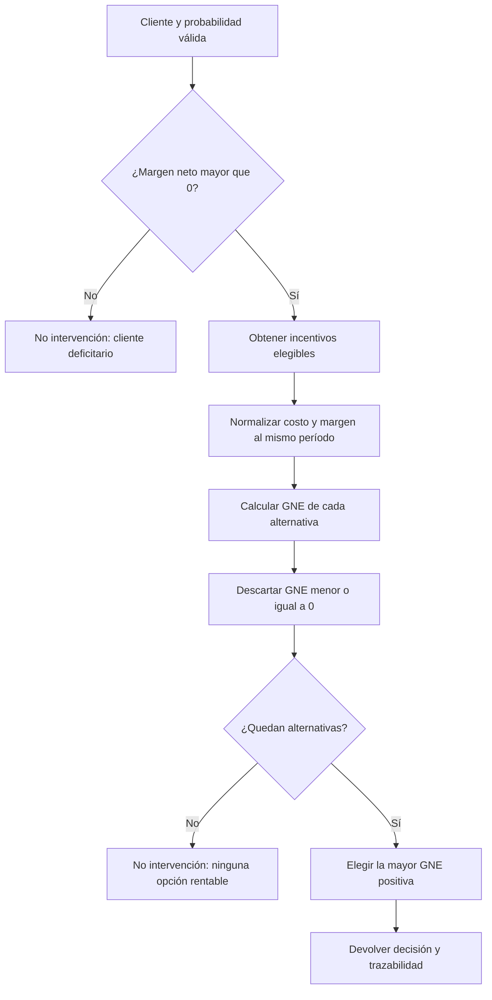

# Modelo financiero de retención

[Volver al README](../README.MD) · [Dataset](dataset.md) · [Arquitectura](architecture.md) · [Aplicación](application.md)

## Estado y propósito

El motor financiero está **planificado y aún no implementado**. Su propósito es transformar una probabilidad de abandono en una decisión económicamente defendible. Riesgo alto no implica por sí solo que deba ofrecerse un incentivo: la intervención debe ser elegible, aplicable a un cliente rentable y producir ganancia neta esperada estrictamente positiva.

Los datos financieros del dataset son simulados y las salidas serán proyecciones académicas, no resultados reales de una campaña bancaria.

## Ganancia neta esperada

Para un cliente \(c\) y un incentivo \(i\):

\[
GNE_{c,i}=(P_{f,c}\times E_i\times M_c)-C_i
\]

| Símbolo | Significado | Restricción |
|---|---|---|
| \(P_{f,c}\) | Probabilidad de abandono estimada por el modelo para el cliente. | Valor finito en `[0, 1]`; no usar `Exited`. |
| \(E_i\) | Efectividad estimada del incentivo. | Proporción en `[0, 1]`, con fuente o supuesto documentado. |
| \(M_c\) | Margen económico comparable del cliente. | En la versión inicial se prevé `AnnualNetMargin_USD_Sim`; debe ser positivo. |
| \(C_i\) | Costo total comparable del incentivo. | No negativo y expresado en el mismo período y moneda que el margen. |

La interpretación de \(P_f\times E_i\) es la probabilidad esperada de evitar la pérdida atribuible a la intervención bajo los supuestos adoptados. La fórmula no demuestra causalidad; la efectividad deberá validarse en un contexto real antes de tomar decisiones productivas.

## Márgenes y período

El dataset distingue:

- ingreso anual por comisiones: `AnnualCommissionIncome_USD_Sim`;
- margen financiero anual: `AnnualFinancialMargin_USD_Sim`;
- costos operativos anuales: `AnnualOperatingCosts_USD_Sim`;
- margen neto anual: `AnnualNetMargin_USD_Sim`.

El motor utilizará un único concepto de margen configurado y documentado. La propuesta inicial es el margen neto anual simulado porque incorpora ingresos, margen financiero y costos. Antes de programar se deberá validar la fórmula de generación de este campo.

Todos los costos de incentivos deberán convertirse al mismo horizonte anual y a USD si el catálogo usa otra periodicidad o unidad. No se mezclarán costos mensuales con márgenes anuales sin una conversión explícita.

Un cliente con \(M_c\leq 0\) es deficitario para esta regla y no será intervenido, aunque su probabilidad de abandono sea alta.

## Catálogo de incentivos

El archivo `Deep_Retention_Catalogo_Incentivos.csv` no está presente. Por ello, la documentación no atribuye columnas ni valores reales al catálogo. Cuando se reciba, deberán verificarse como mínimo los conceptos de identificación, nombre, costo, efectividad y condiciones de elegibilidad según su esquema real.

Las categorías comerciales previstas incluyen:

- atención por gestor VIP;
- tarifas preferenciales;
- exoneración de comisiones;
- bonificaciones transaccionales;
- no intervención.

Esta lista expresa tipos de acción requeridos, no confirma registros existentes en un CSV.

## Elegibilidad y selección

El algoritmo funcional será:

Reglas obligatorias:

1. Validar entradas, unidades y rangos.
2. Aplicar condiciones de elegibilidad antes de comparar alternativas.
3. Calcular la GNE para todas las alternativas elegibles.
4. Descartar cada resultado con `GNE <= 0`.
5. Elegir la mayor GNE positiva mediante un desempate determinista que se definirá con el catálogo.
6. Registrar «No intervención» si el margen no es positivo o ninguna alternativa es rentable.
7. Conservar el detalle de cálculo para auditoría y explicación al usuario.

## Segmentación comercial frente a decisión financiera

`ProfitabilitySegment_Sim` clasifica al cliente como `Rentable` o `No rentable` según una regla simulada preexistente. Los futuros segmentos de riesgo, derivados de la probabilidad, también serán categorías descriptivas.

Ninguna categoría autoriza por sí misma una acción. La decisión final debe recalcularse con los valores numéricos vigentes, las reglas de elegibilidad y `GNE > 0`. Esto evita confundir una etiqueta comercial con una recomendación económica.

## Indicadores agregados

Las definiciones definitivas deberán quedar codificadas y probadas antes de mostrar cifras. Conceptualmente:

| Indicador | Definición prevista |
|---|---|
| Clientes analizados | Número de clientes con datos válidos y predicción disponible. |
| Clientes de alto riesgo | Conteo según segmentos descriptivos cuyos límites estarán documentados; no equivale a clientes intervenidos. |
| Capital total en riesgo | Agregación del importe económico expuesto ponderado por la probabilidad; el campo base exacto debe aprobarse antes de implementarlo. |
| Capital rescatable estimado | Valor esperado preservado por las intervenciones seleccionadas, antes de restar sus costos. |
| Inversión total | Suma de costos de incentivos seleccionados. |
| Ganancia neta esperada total | Suma de las GNE de las intervenciones autorizadas. |
| ROI proyectado | Relación entre ganancia neta esperada total e inversión total. |

Para una cartera \(S\) de intervenciones seleccionadas se propone:

\[
\text{Valor rescatable}=\sum_{(c,i)\in S} P_{f,c}E_iM_c
\]

\[
\text{Inversión}=\sum_{(c,i)\in S} C_i
\]

\[
\text{GNE total}=\text{Valor rescatable}-\text{Inversión}
\]

\[
\text{ROI proyectado}=\frac{\text{GNE total}}{\text{Inversión}}
\]

Si la inversión es cero, el ROI no se mostrará como cero ni infinito: se indicará «No aplicable». La definición de «capital total en riesgo» queda deliberadamente pendiente porque `Balance` y margen representan conceptos distintos y la documentación recibida no fija cuál usar.

## Simulación

El simulador permitirá crear escenarios temporales variando costos, efectividades y otros supuestos aprobados. Cada escenario deberá:

- partir de una copia en memoria de los parámetros;
- recalcular elegibilidad, GNE, inversión y ROI;
- identificar los parámetros modificados respecto al escenario base;
- no alterar `data/Deep_Retention_Dataset.csv` ni el catálogo;
- permitir volver a los valores base de forma clara;
- mantener coherencia de moneda y período.

Los escenarios no modifican las probabilidades del MLP salvo que cambien datos predictivos, algo fuera del simulador financiero previsto.

## Pruebas requeridas

El motor deberá contar con pruebas para:

- cálculo exacto de la fórmula;
- límites `P_f = 0` y `P_f = 1`;
- rechazo de `GNE = 0` y `GNE < 0`;
- rechazo de clientes con margen cero o negativo;
- filtrado por elegibilidad;
- selección de la mayor GNE positiva;
- comportamiento determinista ante empates;
- consistencia de agregados;
- ROI no aplicable con inversión cero;
- aislamiento de simulaciones respecto a los CSV.

## Supuestos y limitaciones

- Las efectividades serán estimaciones, no efectos causales demostrados, salvo evidencia futura.
- Los campos financieros actuales son simulados.
- La GNE es sensible a la calibración de la probabilidad y a los supuestos de costo, efectividad y margen.
- La fórmula no incorpora valor temporal del dinero, duración de la retención, canibalización, restricciones presupuestarias ni capacidad operativa; añadirlos requeriría ampliar explícitamente el alcance.
- No existe todavía catálogo verificable ni reglas reales de elegibilidad.
- Las proyecciones no deben presentarse como ingresos realizados ni promesas de retorno.
- Un umbral fijo de probabilidad no sustituye el análisis económico por alternativa.
