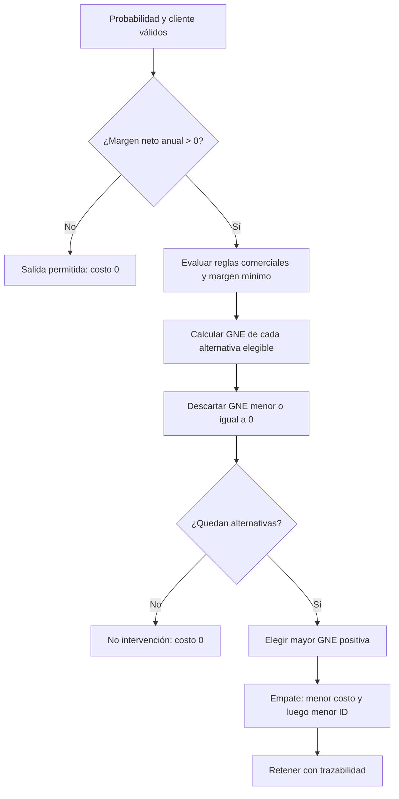

# Modelo financiero de retención

[Volver al README](../README.MD) · [Dataset](dataset.md) · [Arquitectura](architecture.md) · [Aplicación](application.md)

## Estado y propósito

El motor está implementado en [`src/financial.py`](../src/financial.py), integrado con la inferencia en [`04_analisis_financiero.ipynb`](../notebooks/04_analisis_financiero.ipynb) y cubierto por Pytest. Convierte una probabilidad ajustada de abandono en una decisión económica trazable; no utiliza `Exited` ni un umbral fijo de probabilidad.

Todos los importes financieros con sufijo `_USD_Sim`, los costos, las efectividades y las reglas comerciales son supuestos académicos. Las salidas son proyecciones, no resultados observados de una campaña ni eficacia causal demostrada.

## Ganancia neta esperada

Para un cliente (c) y un incentivo (i):

\[
GNE_{c,i}=(P_{f,c}\times E_i\times M_c)-C_i
\]

| Símbolo | Implementación |
|---|---|
| (P_{f,c}) | Probabilidad ajustada, finita y en `[0, 1]`, producida por `PredictorFuga`. |
| (E_i) | Efectividad académica en `[0, 1]` definida en `data/incentivos.csv`. |
| (M_c) | `AnnualNetMargin_USD_Sim`, margen neto anual simulado en USD. |
| (C_i) | `costo_anual_usd`, costo académico anual en USD. |

`AnnualNetMargin_USD_Sim` ya incorpora el ingreso por comisiones y el margen financiero, menos los costos operativos. El motor no suma nuevamente esos componentes y evita así una doble contabilización. Los 10.000 registros cumplen:

\[
\text{AnnualCommissionIncome} + \text{AnnualFinancialMargin}
- \text{AnnualOperatingCosts} = \text{AnnualNetMargin}
\]

con diferencia máxima observada de USD 0,00.

## Catálogo y reglas comerciales

El catálogo versionado contiene cuatro alternativas:

| Incentivo | Costo anual USD | Efectividad | Margen mínimo USD | Condición comercial |
|---|---:|---:|---:|---|
| Bonificación transaccional | 20 | 20 % | 0 | Transacciones mensuales desde p50. |
| Exoneración de comisiones | 50 | 40 % | 150 | Ingreso anual por comisiones desde p50. |
| Tasa preferencial | 100 | 55 % | 400 | `Balance` desde p75 y volumen mensual desde p50. |
| Gestor personalizado | 200 | 75 % | 800 | `Balance` desde p90 y volumen mensual desde p75. |

Los percentiles se calculan sobre la cartera analizada. En la versión actual los cortes reproducibles son:

| Variable | Percentil | Corte observado |
|---|---:|---:|
| `MonthlyTransactions_Sim` | p50 | 20 transacciones/mes |
| `AnnualCommissionIncome_USD_Sim` | p50 | USD 111,60/año |
| `Balance` | p75 | 127.644,24 en unidad no declarada |
| `Balance` | p90 | 149.244,792 en unidad no declarada |
| `MonthlyTransactionVolume_USD_Sim` | p50 | USD 4.500,66/mes |
| `MonthlyTransactionVolume_USD_Sim` | p75 | USD 7.170,1225/mes |

La unidad de `Balance` no está declarada. Por eso se utiliza únicamente su posición relativa dentro del dataset; no se etiqueta como USD ni se convierte a otra moneda.

## Validación del catálogo

`validar_catalogo()` rechaza catálogos vacíos, incompletos, con faltantes, identificadores o nombres duplicados, importes no finitos, costos o márgenes mínimos negativos, efectividades fuera de `[0, 1]`, percentiles fuera de `[0, 1]` y perfiles desconocidos.

Joblib y Keras solo cargan artefactos confiables incluidos en el proyecto. El catálogo se trata como entrada de solo lectura.

## Selección y decisiones

El flujo implementado es:



Las tres decisiones tienen significados diferentes:

- **Salida permitida:** margen neto anual menor o igual a cero; se bloquea cualquier gasto.
- **No intervención:** cliente rentable, pero ninguna alternativa es simultáneamente elegible y económicamente positiva.
- **Retener:** existe al menos una alternativa elegible con `GNE > 0` y se selecciona la mayor.

Cada resultado conserva probabilidad, margen anual, incentivo, perfil requerido, efectividad, costo, GNE, elegibilidad, motivo y detalle de todas las alternativas evaluadas. El criterio de desempate es determinista: menor costo anual y, si persiste el empate, menor `incentivo_id`.

## Evaluación consolidada

La ejecución completa sobre los 10.000 clientes produjo:

| Indicador | Resultado |
|---|---:|
| Retener | 1.214 |
| No intervención | 5.184 |
| Salida permitida | 3.602 |
| Inversión proyectada | USD 66.640,00 |
| Valor rescatable estimado | USD 156.739,69 |
| GNE total | USD 90.099,69 |
| ROI proyectado | 135,20 % |

Distribución de las 1.214 recomendaciones:

| Incentivo | Clientes |
|---|---:|
| Exoneración de comisiones | 536 |
| Bonificación transaccional | 367 |
| Tasa preferencial | 297 |
| Gestor personalizado | 14 |

Ninguno de los 3.602 clientes con margen no positivo recibe un incentivo. Todas las recomendaciones tienen GNE estrictamente positiva.

La primera implementación recomendaba 2.319 intervenciones y proyectaba USD 161.651,15 de GNE. Las nuevas reglas reducen las intervenciones en 1.105 y la GNE en USD 71.551,46 porque exigen coherencia entre la acción y el perfil transaccional, de comisiones, volumen o patrimonio relativo. No se forzaron los resultados anteriores.

## Agregados

Para las intervenciones seleccionadas (S):

\[
\text{Valor rescatable}=\sum_{(c,i)\in S} P_{f,c}E_iM_c
\]

\[
\text{Inversión}=\sum_{(c,i)\in S} C_i
\]

\[
\text{GNE total}=\text{Valor rescatable}-\text{Inversión}
\]

\[
\text{ROI proyectado}=\frac{\text{GNE total}}{\text{Inversión}}
\]

Si la inversión es cero, el ROI se devuelve como no aplicable (`None`), nunca como infinito.

## Pruebas y reproducción

Las pruebas cubren probabilidades límite e inválidas, márgenes no positivos, GNE negativa/cero/positiva, elegibilidad, selección óptima, empates, catálogos inválidos, bloqueo de deficitarios y consistencia de agregados:

```bash
uv run pytest -q
```

El análisis completo se reproduce ejecutando `notebooks/04_analisis_financiero.ipynb` después de disponer de los artefactos exportados.

## Limitaciones

- Las efectividades y los costos son supuestos académicos, no estimaciones causales.
- La corrección de probabilidades por pesos de clase es aproximada.
- La cartera contiene registros utilizados durante el desarrollo del modelo; el resultado financiero no es una evaluación predictiva independiente.
- La fórmula no incorpora valor temporal del dinero, duración de la retención, canibalización, presupuesto ni capacidad operativa.
- Toda cifra es una proyección simulada y no debe presentarse como ganancia realizada.
