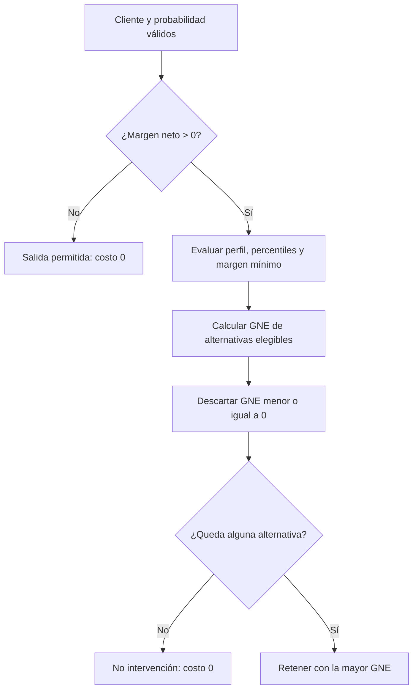

# Modelo financiero de retención

[Volver al README](../README.MD) · [Dataset](dataset.md) · [Aprendizaje automático](machine-learning.md) · [Arquitectura](architecture.md) · [Aplicación](application.md)

## Propósito y alcance

El dataset original no contiene transacciones, comisiones, costos operativos ni margen bancario suficientes para calcular rentabilidad real por cliente. `04_analisis_financiero.ipynb` construye por ello un escenario académico, simulado, reproducible y auditable. `src/financial.py` aplica después las reglas de elegibilidad y Ganancia Neta Esperada (GNE).

Las variables con sufijo `_Sim`, los costos, las efectividades y los márgenes mínimos son supuestos del ejercicio. No representan datos contables, eficacia causal ni resultados de campañas reales.

## Generación de variables financieras

El notebook parte de las 18 columnas de `data/Customer-Churn-Records.csv`, trabaja sobre una copia y agrega exactamente ocho columnas:

1. `MonthlyTransactions_Sim`
2. `MonthlyTransactionVolume_USD_Sim`
3. `AvgTransactionFee_USD_Sim`
4. `AnnualCommissionIncome_USD_Sim`
5. `AnnualFinancialMargin_USD_Sim`
6. `AnnualOperatingCosts_USD_Sim`
7. `AnnualNetMargin_USD_Sim`
8. `ProfitabilitySegment_Sim`

### Supuestos implementados

| Componente | Regla determinista |
|---|---|
| Transacciones mensuales | `6 + 4×NumOfProducts + 8×IsActiveMember + floor(Tenure/2)` |
| Importe medio hipotético | `65 + 15×NumOfProducts + 20×IsActiveMember` USD simulados |
| Volumen mensual | Transacciones mensuales × importe medio hipotético |
| Comisión promedio | `0,45 + 0,10×NumOfProducts` USD simulados |
| Ingreso anual por comisiones | Transacciones × comisión promedio × 12 |
| Contribución por saldo | USD 0, 120, 240, 420 o 700 según saldo cero o cuartil de saldos positivos |
| Contribución financiera anual | Segmento de saldo + `70×NumOfProducts + 60×IsActiveMember` |
| Costos operativos anuales | `90 + 25×NumOfProducts + 0,80×Transacciones×12` |

Los cuartiles de `Balance` se calculan solo entre saldos positivos: 100.181,975; 119.839,690 y 139.512,290 en la unidad original no declarada.

Las magnitudes se eligieron para ilustrar de forma sencilla cómo productos, actividad, antigüedad, transacciones y servicio afectan la rentabilidad; no se ajustaron para alcanzar una cantidad predeterminada de clientes rentables o campañas. No se usa aleatoriedad: con los mismos datos y parámetros, el resultado es idéntico.

`Exited` y `Complain` no intervienen en la simulación. `EstimatedSalary` describe al cliente, pero tampoco se convierte en ingreso bancario.

## Margen neto anual

La identidad implementada es:

\[
\text{Margen neto}=\text{Ingresos por comisiones}+\text{Contribución financiera}-\text{Costos operativos}
\]

`ProfitabilitySegment_Sim` toma el valor `Rentable` cuando `AnnualNetMargin_USD_Sim > 0` y `Deficitario` en caso contrario. El escenario actual contiene 7.880 clientes rentables y 2.120 deficitarios.

`Balance` no se multiplica por una tasa para convertirlo directamente en beneficio. Solo determina un segmento relativo por percentiles y también participa en reglas comerciales del catálogo. Su moneda no está documentada.

## Integración con el MLP

`PredictorFuga` calcula una probabilidad ajustada para los 10.000 clientes usando exclusivamente las nueve características del modelo. El notebook guardado verificó:

- 10.000 probabilidades;
- rango aproximado `0,001482–0,999994`;
- valores finitos dentro de `[0, 1]`;
- correspondencia preservada entre cada `CustomerId` y su probabilidad.

Las ocho columnas financieras no entran al MLP. La probabilidad y el margen simulado se combinan únicamente en el motor posterior.

## Ganancia Neta Esperada

Para un cliente `c` y un incentivo `i`:

\[
GNE_{c,i}=(P_{f,c}\times E_i\times M_c)-C_i
\]

| Símbolo | Implementación |
|---|---|
| `P_f` | Probabilidad ajustada de abandono producida por el MLP. |
| `E_i` | Efectividad hipotética del incentivo. |
| `M_c` | `AnnualNetMargin_USD_Sim`. |
| `C_i` | Costo anual supuesto del incentivo. |

El umbral diagnóstico `0,5` no participa en esta selección.

## Catálogo de incentivos

| Incentivo | Costo anual | Efectividad supuesta | Margen mínimo | Perfil y regla comercial |
|---|---:|---:|---:|---|
| Bonificación transaccional | USD 20 | 20 % | USD 0 | Transacciones desde p50. |
| Exoneración de comisiones | USD 50 | 40 % | USD 150 | Comisiones anuales desde p50. |
| Tasa preferencial | USD 100 | 55 % | USD 400 | `Balance` desde p75 y volumen desde p50. |
| Gestor personalizado | USD 200 | 75 % | USD 800 | `Balance` desde p90 y volumen desde p75. |

Los cortes calculados sobre la cartera completa son:

| Variable | Percentil | Corte |
|---|---:|---:|
| `MonthlyTransactions_Sim` | p50 | 18 transacciones/mes |
| `AnnualCommissionIncome_USD_Sim` | p50 | USD 132,00/año |
| `Balance` | p75 | 127.644,24 unidades originales |
| `Balance` | p90 | 149.244,792 unidades originales |
| `MonthlyTransactionVolume_USD_Sim` | p50 | USD 1.805,00/mes |
| `MonthlyTransactionVolume_USD_Sim` | p75 | USD 2.530,00/mes |

Costos, efectividades, márgenes mínimos y perfiles son hipótesis académicas. No proceden de campañas ni fueron aprendidos por el MLP. `validar_catalogo()` comprueba esquema, duplicados, faltantes, finitud y dominios antes de evaluar clientes.

## Decisiones

- **Retener:** cliente rentable con al menos una alternativa comercialmente elegible y GNE estrictamente positiva.
- **No intervención:** cliente rentable sin alternativa simultáneamente elegible y económicamente conveniente.
- **Salida permitida:** margen neto anual menor o igual a cero; se bloquea todo gasto.

En un empate se prefiere menor costo anual y luego menor `incentivo_id`. Cada resultado conserva las cuatro alternativas, elegibilidad, motivo de rechazo, costo, efectividad y GNE.

## Resultados del escenario base

Las salidas guardadas del notebook 04 y el motor integrado producen:

| Indicador | Resultado |
|---|---:|
| Clientes evaluados | 10.000 |
| Clientes rentables | 7.880 |
| Clientes deficitarios | 2.120 |
| Retener | 793 |
| No intervención | 7.087 |
| Salida permitida | 2.120 |
| Inversión proyectada | USD 35.600,00 |
| Beneficio bruto esperado | USD 77.780,78 |
| Ganancia Neta Esperada total | USD 42.180,78 |
| ROI proyectado | 118,49 % |

Distribución de las 793 recomendaciones:

| Incentivo | Clientes |
|---|---:|
| Exoneración de comisiones | 350 |
| Bonificación transaccional | 335 |
| Tasa preferencial | 102 |
| Gestor personalizado | 6 |

Ningún cliente con margen no positivo recibe un incentivo y toda retención recomendada tiene GNE positiva y cumple las reglas comerciales.

## Agregados del panel

Para las intervenciones seleccionadas `S`:

\[
\text{Beneficio bruto esperado}=\sum_{(c,i)\in S}P_{f,c}E_iM_c
\]

\[
\text{Inversión}=\sum_{(c,i)\in S}C_i
\]

\[
\text{GNE total}=\text{Beneficio bruto esperado}-\text{Inversión}
\]

\[
\text{ROI proyectado}=\frac{\text{GNE total}}{\text{Inversión}}\times100
\]

Si la inversión es cero, el ROI es no aplicable.

El panel también calcula:

- **Saldo expuesto:** `Σ(P_f × Balance)` para la cartera mostrada, en unidades originales no declaradas.
- **Abandonos esperados evitados:** `Σ(P_f × E_i)` entre clientes retenidos.
- **Efectividad ponderada por riesgo:** el indicador anterior dividido entre `ΣP_f` de los clientes retenidos, si el denominador es positivo.

Estos valores dependen de probabilidades y efectividades estimadas; no son dinero perdido, abandonos observados ni evidencia causal.

## Reproducibilidad y simulación

El notebook verifica que una segunda generación produzca exactamente las mismas ocho columnas, conserva las 18 originales, comprueba la identidad del margen y exporta 10.000×26 a `clientes_financieros_simulados.csv`.

El simulador de Streamlit crea una copia temporal del catálogo, reutiliza las probabilidades y percentiles del escenario base y recalcula solo elegibilidad y GNE. Nunca sobrescribe el CSV financiero ni `data/incentivos.csv`.

## Limitaciones

- Los parámetros financieros y efectividades no están estimados con datos reales.
- El escenario no incluye valor temporal del dinero, duración de la retención, canibalización, presupuesto ni capacidad operativa.
- La cartera incluye registros usados durante el desarrollo del modelo; el análisis financiero no es una evaluación predictiva independiente.
- GNE y ROI son proyecciones simuladas, no beneficios realizados.
