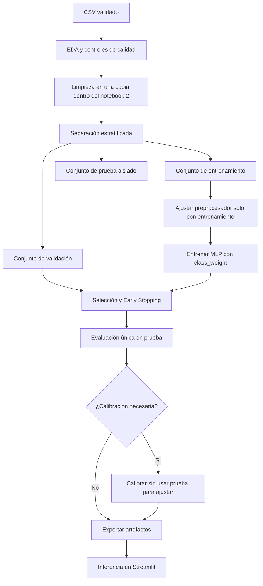

# Aprendizaje automático

[Volver al README](../README.MD) · [Dataset](dataset.md) · [Arquitectura](architecture.md) · [Desarrollo](development.md) · [Hoja de ruta](roadmap.md)

## Estado y objetivo

El [EDA](eda-results.md), el preprocesamiento reproducible y el primer entrenamiento del MLP ya están implementados como notebooks independientes. El EDA solo diagnostica el CSV; [`02_preprocesamiento.ipynb`](../notebooks/02_preprocesamiento.ipynb) prepara las particiones y [`03_red_neuronal.ipynb`](../notebooks/03_red_neuronal.ipynb) reproduce ese preprocesamiento para entrenar un primer modelo con ponderación de clases. Solo existen métricas iniciales de validación: el conjunto de prueba permanece reservado y todavía no se han realizado la evaluación final, la calibración ni la exportación de artefactos.

El objetivo es aprender, mediante clasificación supervisada, una función que estime:

\[
P(\texttt{Exited}=1 \mid X)
\]

para cada cliente. La salida será una probabilidad entre 0 y 1 y alimentará el motor financiero. El valor histórico `Exited` se utilizará únicamente como etiqueta durante el desarrollo y la evaluación; nunca se mostrará como si fuera la predicción del modelo.

## Datos de entrada

Las nueve características autorizadas son:

| Tipo | Características |
|---|---|
| Numéricas para escalado | `CreditScore`, `Age`, `Tenure`, `Balance`, `NumOfProducts`, `EstimatedSalary` |
| Categórica nominal | `Geography` |
| Binarias en passthrough | `HasCrCard`, `IsActiveMember` |

`HasCrCard` e `IsActiveMember` son indicadores binarios y se validan como `0` o `1`. `CustomerId`, `Surname`, `Gender`, todas las columnas `_Sim` y `Exited` quedan fuera de la matriz predictora. Véase el [diccionario del dataset](dataset.md).

## Proceso experimental



## Análisis exploratorio implementado

El análisis reproducible ejecutado antes del entrenamiento cubre:

- dimensiones, esquema y tipos inferidos;
- estadística descriptiva adecuada a cada tipo;
- faltantes y registros duplicados;
- rangos inválidos y valores atípicos, sin eliminarlos automáticamente;
- distribución de `Exited` y cuantificación del desbalance;
- distribuciones por clase y relaciones bivariadas relevantes;
- asociaciones entre características, redundancias y posibles proxies;
- visualizaciones con títulos, unidades y población claramente identificados.

El EDA versionado confirmó 10.000 filas, ninguna celda vacía, 92 apellidos con `?` y una tasa histórica de abandono de 20,37 %. Solo informa estos resultados; no modifica los apellidos ni crea un DataFrame depurado.

## Limpieza previa al preprocesamiento

`02_preprocesamiento.ipynb` carga el CSV original de forma independiente y crea `df_clean` como copia en memoria. En esa copia:

- elimina espacios exteriores de las columnas de texto mediante `str.strip()`;
- reemplaza completos por `pd.NA` los 92 apellidos que contienen `?`, sin intentar reconstruirlos;
- conserva las 10.000 filas y todos los `CustomerId`;
- obtiene 92 valores faltantes únicamente en `Surname` y cero faltantes en las nueve predictoras;
- no escribe cambios en el CSV original.

Después de esta limpieza se seleccionan `X` e `y` y se realizan las particiones. Como `Surname` está excluido de `X`, no se incorpora imputación al `ColumnTransformer`.

## División de conjuntos implementada

La separación se realiza en dos etapas con `train_test_split`, `stratify` y `random_state=42`. Produce conjuntos independientes con las siguientes dimensiones:

| Conjunto | Registros | Proporción | Abandonos | Tasa de abandono |
|---|---:|---:|---:|---:|
| Entrenamiento | 7.000 | 70 % | 1.426 | 20,37 % |
| Validación | 1.500 | 15 % | 306 | 20,40 % |
| Prueba | 1.500 | 15 % | 305 | 20,33 % |

Las intersecciones entre los índices de los tres conjuntos son vacías y sus tamaños suman los 10.000 registros originales.

Reglas contra fuga de información:

1. Separar los registros antes de ajustar imputadores, escaladores o codificadores.
2. Ajustar todos los transformadores exclusivamente con entrenamiento.
3. Usar validación para selección de arquitectura, hiperparámetros, época y umbral descriptivo.
4. Mantener prueba aislada hasta elegir el pipeline final.
5. No utilizar variables financieras simuladas para predecir `Exited`.
6. No utilizar el conjunto de prueba para calibrar probabilidades.

Si en el futuro se incorporan observaciones temporales o múltiples filas por cliente, la estrategia de partición deberá cambiar para impedir solapamiento o anticipación temporal.

## Pipeline de preprocesamiento implementado

El `ColumnTransformer` implementado preserva nombres y orden de características:

- **Validación:** comprueba las nueve columnas requeridas, faltantes, valores finitos, dominios binarios y ausencia de solapamiento entre particiones.
- **Numéricas:** `StandardScaler` transforma las seis variables usando exclusivamente medias y desviaciones del entrenamiento.
- **Categórica:** `OneHotEncoder(handle_unknown="ignore")` transforma `Geography` en `Geography_France`, `Geography_Germany` y `Geography_Spain`.
- **Binarias:** `HasCrCard` e `IsActiveMember` se conservan mediante passthrough.
- **Imputación:** no se incorpora porque las nueve predictoras no presentan valores faltantes.

El preprocesador solo recibe `fit_transform` sobre `X_train`; validación y prueba reciben únicamente `transform`. Las matrices resultantes son:

| Matriz | Dimensiones | Tipo |
|---|---:|---|
| `X_train_processed` | 7.000 × 11 | `float32` |
| `X_val_processed` | 1.500 × 11 | `float32` |
| `X_test_processed` | 1.500 × 11 | `float32` |

Las 11 columnas finales corresponden a seis numéricas estandarizadas, tres indicadores geográficos y dos variables binarias. No contienen valores `NaN` ni infinitos y son compatibles con la futura entrada de Keras.

La exportación a `models/preprocesador.joblib` sigue pendiente. Se realizará junto con el entrenamiento para guardar exactamente el transformador utilizado por el modelo aprobado; Streamlit no reconstruirá las transformaciones manualmente.

## Arquitectura implementada del MLP

El primer modelo utiliza la API Sequential de TensorFlow/Keras 2.21.0:

| Etapa | Configuración implementada |
|---|---|
| Entrada | 11 características producidas dinámicamente por el preprocesador. |
| Capa oculta 1 | 128 unidades, ReLU. |
| Regularización 1 | Batch Normalization y Dropout de 0,25. |
| Capa oculta 2 | 64 unidades, ReLU. |
| Regularización 2 | Dropout de 0,15. |
| Salida | 1 unidad con Sigmoid. |
| Parámetros | 10.369 totales: 10.113 entrenables y 256 no entrenables. |
| Optimizador | Adam con tasa de aprendizaje predeterminada. |
| Pérdida | Binary Crossentropy. |
| Métricas de seguimiento | Binary Accuracy, ROC-AUC y PR-AUC. |

ReLU aporta no linealidad, Batch Normalization estabiliza las activaciones y Dropout limita la dependencia excesiva entre neuronas. Sigmoid restringe la salida a `[0, 1]`, pero no garantiza por sí sola que las probabilidades estén calibradas.

## Entrenamiento y desbalance implementados

La ejecución fija la semilla 42 y calcula `class_weight="balanced"` exclusivamente con `y_train`:

| Clase | Registros de entrenamiento | Proporción | Peso |
|---|---:|---:|---:|
| `0` — permaneció | 5.574 | 79,63 % | 0,6279 |
| `1` — abandonó | 1.426 | 20,37 % | 2,4544 |

Los pesos se pasan a `model.fit()` mediante `class_weight`; no se aplica SMOTE ni se duplican o eliminan clientes. La validación conserva su distribución original.

El entrenamiento utiliza un máximo de 100 épocas, `batch_size=32` y Early Stopping con `monitor="val_loss"`, paciencia 12 y `restore_best_weights=True`. Se ejecutaron 39 épocas; la menor pérdida de validación apareció en la época 27 (`val_loss = 0,4184`) y esos pesos fueron restaurados. Las curvas muestran aprendizaje durante las primeras épocas y un sobreajuste leve posterior, limitado por Early Stopping.

## Resultados iniciales de validación

Las probabilidades se generaron únicamente para los 1.500 registros de validación y todas fueron finitas y pertenecieron a `[0, 1]`:

| Métrica | Validación |
|---|---:|
| ROC-AUC | 0,8669 |
| Average Precision | 0,7099 |
| Brier Score | 0,1354 |

Con los mejores pesos restaurados, Keras registró accuracy 0,8040 y PR-AUC 0,7093 en validación, frente a accuracy 0,8266 y PR-AUC 0,7432 en entrenamiento. La diferencia sugiere sobreajuste leve. Estas cifras son resultados de validación, no una evaluación definitiva ni evidencia de idoneidad para producción bancaria. La ponderación de clases puede afectar la calibración, que todavía no se ha ajustado.

## Evaluación

El conjunto de prueba deberá producir, como mínimo:

| Métrica o artefacto | Propósito |
|---|---|
| ROC-AUC | Capacidad de ordenamiento a través de distintos umbrales. |
| PR-AUC | Rendimiento sobre la clase positiva bajo desbalance. |
| Brier Score | Error cuadrático de las probabilidades. |
| Curva de calibración | Correspondencia entre probabilidad estimada y frecuencia observada. |
| Matriz de confusión | Errores para un umbral de análisis declarado. |
| Precision | Proporción de positivos predichos que abandonaron. |
| Recall | Proporción de abandonos históricos detectados. |
| F1-score | Balance armónico entre precision y recall. |

La exactitud podrá reportarse como contexto, pero no será el criterio principal. Los intervalos de confianza o la variabilidad entre semillas son deseables si el calendario lo permite.

### Calibración

Las decisiones económicas multiplican directamente la probabilidad por un margen, por lo que la calibración es crítica. Se comparará la curva de calibración y el Brier Score antes y después de cualquier técnica adicional. Si se aplica calibración, el método se ajustará con datos separados de la prueba final y se exportará como parte inequívoca del flujo de inferencia.

No se añadirá calibración si no mejora evidencia relevante o si introduce fuga de información.

### Umbrales y decisión económica

Un umbral de clasificación puede utilizarse para matrices de confusión, segmentos informativos o análisis de sensibilidad. No reemplaza la regla financiera: la decisión final se obtiene evaluando la GNE de cada incentivo elegible, según se describe en el [modelo financiero](financial-model.md).

## Explicabilidad

Se seleccionará una técnica apropiada para redes neuronales y datos tabulares, por ejemplo importancia por permutación o SHAP, después de verificar compatibilidad y costo computacional. El análisis deberá:

- diferenciar explicaciones globales e individuales;
- operar sobre el pipeline real y documentar el espacio de características interpretado;
- evitar presentar asociación como causalidad;
- comprobar estabilidad y coherencia de los resultados;
- reconocer los límites de interpretar variables codificadas y correlacionadas.

La técnica definitiva y sus resultados quedan pendientes.

## Exportación e inferencia

Los artefactos objetivo son:

```text
models/modelo_churn.keras
models/preprocesador.joblib
```

Antes de exportar se registrarán:

- versión del dataset o huella verificable;
- lista y orden de características;
- partición y semilla;
- versiones de Python, TensorFlow/Keras, Scikit-learn y Joblib;
- arquitectura e hiperparámetros;
- métricas finales y decisión de calibración.

En Streamlit, la inferencia seguirá siempre el orden: validar registro → seleccionar nueve características → transformar con el objeto exportado → ejecutar `predict` con el modelo exportado → validar que la salida sea finita y pertenezca a `[0, 1]` → entregar la probabilidad al motor financiero.

## Limitaciones predictivas

- Los datos son históricos y no prueban causalidad.
- No existe información temporal para medir deriva o cambios de comportamiento.
- El conjunto cubre solo tres geografías observadas.
- Se excluye `Gender` por decisión del proyecto, pero se deberá revisar el rendimiento por subgrupos para detectar disparidades.
- La probabilidad estimada depende de la representatividad, calidad y definición de `Exited`.
- Los resultados académicos no deben presentarse como validación para producción bancaria.
- El rendimiento deberá reevaluarse si cambia el dataset, el preprocesamiento o una dependencia relevante.
